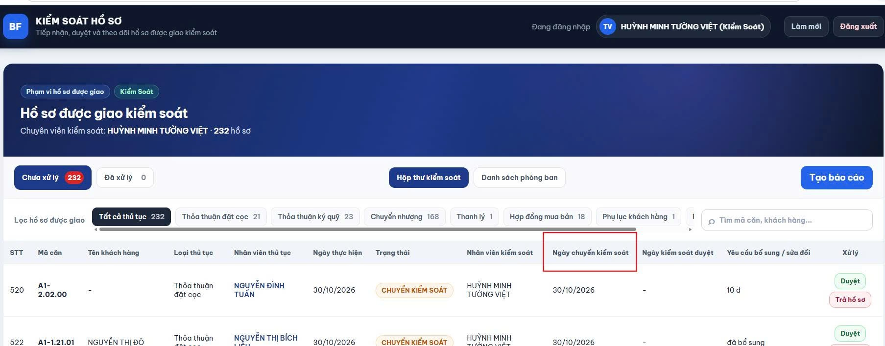

1. bổ sung thêm cái đổi tên người làm của hồ sơ đó hoặc là chỗ xóa hàng trên hệ thống nha -> OK
2. bổ sung cái export danh sách excel của tất cả hồ sơ để tổng hợp dữ liệu luôn nha
3.  -> OK
ví dụ ở chỗ Ngày chuyển kiểm soát này anh cho thêm cái lịch để bấm chọn ngày mình muốn coi, xem ngày hôm đó mình chuyển bao nhiêu căn, thay vì phải lướt lại từng trang coi á -> OK
4. THÊM AVT -> OK
5. THAY ĐỔI MẬT KHẨU VÀ MÃ HÓA -> OK
6. GỬI MAIL KHI QUÊN MK
7. PHÂN BẬC